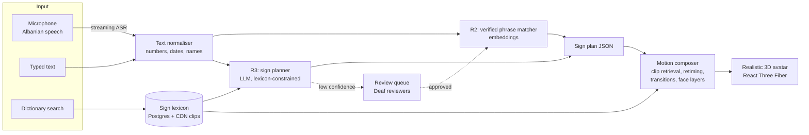
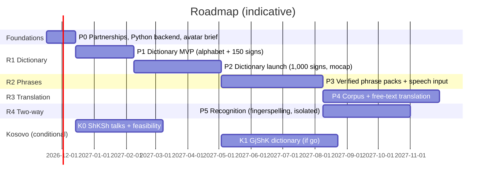

# Making the AI Sign Language Translator Real: Research & Build Plan

**Target language:** Gjuha e Shenjave Shqipe (GjShSh, Albanian Sign Language). Kosovo Sign Language (GjShK) is a planned second language, subject to a partnership (see [section 12.8](#128-kosovo-sign-language-gjshk-conditional-track)).
**Goal:** A real product where **realistic 3D avatars** sign Albanian Sign Language. It starts as a **3D dictionary**, then grows into **verified phrases**, free-text translation, and finally recognition of signing back into text.
**Stack:** Python backend (FastAPI) + React/TypeScript frontend with a three.js avatar.
**Date:** November 2026 · **Version 2**: updated with the project decisions of 13 Nov 2026

---

## Table of contents

1. [Executive summary](#1-executive-summary)
2. [Where the project is today (code audit)](#2-where-the-project-is-today-code-audit)
3. [What the research says](#3-what-the-research-says)
4. [Product scope: dictionary first, then phrases](#4-product-scope-dictionary-first-then-phrases)
5. [Target architecture (Python)](#5-target-architecture-python)
6. [The realistic avatar: rig, appearance, rendering](#6-the-realistic-avatar-rig-appearance-rendering)
7. [Motion data: how the avatar learns each sign](#7-motion-data-how-the-avatar-learns-each-sign)
8. [Language layer: Albanian text to sign plan](#8-language-layer-albanian-text-to-sign-plan)
9. [Speech in, speech out (ASR / TTS)](#9-speech-in-speech-out-asr--tts)
10. [Reverse direction: sign to text](#10-reverse-direction-sign-to-text)
11. [Data, consent, licensing and ethics](#11-data-consent-licensing-and-ethics)
12. [Phased roadmap](#12-phased-roadmap)
13. [Evaluation: how we know it works](#13-evaluation-how-we-know-it-works)
14. [Team, hardware and budget](#14-team-hardware-and-budget)
15. [Risks and mitigations](#15-risks-and-mitigations)
16. [Decisions log and remaining open questions](#16-decisions-log-and-remaining-open-questions)
17. [Immediate next steps (first two weeks)](#17-immediate-next-steps-first-two-weeks)
18. [References](#18-references)

---

## 1. Executive summary

The current app is a proof of concept: it records Albanian speech, runs Whisper locally, and tries to play scraped fingerspelling videos. Several parts are disconnected or broken (section 2), and the sign data was scraped from a source whose licence forbids copying.

We are building it **for real, as a product**. The core is a **lexicon-driven 3D avatar pipeline**, the architecture that serious production systems (Signapse, Kara, Hand Talk, sign.mt) converge on:

```
Verified sign lexicon (motion-captured from Deaf signers)
        │
        ├──► 3D Dictionary          (release 1: look up any sign, learn, fingerspell)
        ├──► Verified phrase packs  (release 2: speech/text → matching reviewed phrase → avatar)
        └──► Free-text translation  (release 3: LLM sign planner constrained to the lexicon)
```

### Decisions taken (13 Nov 2026)

| Decision | Choice | What it changes |
|---|---|---|
| Ambition | **Build it for real, as a product** | Production pipeline must use only commercially usable licences (no research-only body models without a licence); quality bars and Deaf validation are mandatory |
| Languages | **Albanian Sign Language first; Kosovo if we can get the vocabulary** | Architecture is multi-language from day 1. Kosovo has a public dictionary of ~1,467 general signs (gjshk.org) but no published reuse licence, so it becomes a **conditional track** with a go/no-go gate |
| Avatar | **Realistic** | Character Creator 5 + Headshot + professional 3D artist, physically based skin/eyes/hair in the browser, early uncanny-valley testing with Deaf users |
| Backend | **Python** | FastAPI replaces Express; one language for API, ML, and the capture pipeline. The browser UI stays React + TypeScript (browsers run JavaScript) |
| Order | **Dictionary first, then phrases** | Release 1 is a 3D dictionary + learning app; phrases come in release 2; open translation in release 3 |

### Key recommendations

| Area | Recommendation |
|---|---|
| **Partnership** | Make ANAD (Albanian National Association of the Deaf, who run gjshsh.al) a formal partner before anything else. They hold the only curated GjShSh dictionary (1,040 signs) and the linguistic authority. Open a parallel conversation with the Kosovo Association of the Deaf (ShKSh). |
| **Motion data** | Bootstrap with licensed dictionary videos where possible, but make **motion capture of Deaf signers** (gloves + suit + iPhone face capture) the production source, starting with the alphabet and the most frequent signs. |
| **Avatar** | Realistic humanoid with full finger bones, 52 ARKit facial blendshapes + mouthing visemes; rendered with React Three Fiber; we own the assets (Ready Player Me shut down in January 2026). |
| **Dictionary (R1)** | Search by Albanian word (inflections handled), topic and handshape; 3D sign page with speed, loop, angles and mirror; fingerspell any word; learning mode and quizzes; offline-capable PWA. |
| **Phrases (R2)** | Deaf-reviewed phrase packs per domain (health, municipality, transport, school, bank). Speech or text input is matched to the closest **verified** phrase, so the avatar never improvises in this release. |
| **Translation (R3)** | LLM sign planner constrained to the lexicon, fingerspelling fallback, confidence display; later a fine-tuned open model on our own parallel corpus. |
| **ASR / TTS** | Replace Whisper medium (Whisper large-v3 is ~56% WER on Albanian FLEURS). Benchmark Meta Omnilingual ASR (~4.6% CER standard Albanian, ~33% CER Gheg) against Azure/Google. TTS: Azure `sq-AL-AnilaNeural` / `sq-AL-IlirNeural`. |

**Indicative timeline** (small team of 4 to 6 people + paid Deaf consultants): dictionary public launch at around **5 to 6 months**, phrase packs at around **9 months**, free-text translation at around **12 to 14 months**. Kosovo dictionary can run in parallel from roughly month 6 if the go/no-go gate passes.

---

## 2. Where the project is today (code audit)

### 2.1 What exists

| Part | Files | What it does |
|---|---|---|
| Frontend | `frontend/sign-language-translator/` (Create React App, React 19, Tailwind) | Home page, Speech-to-Sign page, Sign Keyboard page |
| Backend | `backend/server.js`, `backend/routes/*` (Express) | `/api/speech-to-text` (local Whisper CLI), `/api/text-to-speech` (Aivoov), `/api/sign-videos` (static files) |
| Dataset | `sign-scraper/sign-language-dataset/alphabet/` | 36 fingerspelling clips (`k_a.mp4` … `k_zh.mp4`, including the digraphs and `ç`/`ë`), plus partner logos |
| Scraper | `sign-scraper/scraper.py` | Downloads all `<video>`/`` from `gjshsh.al/daktilim/` |

### 2.2 What is broken or risky

1. **Speech-to-sign never returns a video.** `SpeechToSignPage.tsx` calls `GET /api/sign-videos?word=...`, but `routes/signVideos.js` only defines `/list` and `/:filename`.
2. **The video route points to a folder that does not exist.** `VIDEO_DIR` is `backend/sign-language-dataset`; the clips live in `sign-scraper/sign-language-dataset/alphabet`.
3. **The Whisper output is raw CLI stdout.** It includes timestamp lines and writes `.txt/.srt/.vtt` files to the working directory; the model reloads on every request; uploads are never deleted; `exec` with string interpolation is used.
4. **Audio format mismatch.** `react-mic` produces WebM/Opus, but the upload is named `recording.wav`.
5. **`signVideoMap.ts` is wrong.** `faleminderit` maps to `k_zh.mp4` (the letter ZH); the paths will not resolve in the browser.
6. **The alphabet keyboard has errors.** `signAlphabet.ts` lists `C` and `E` twice instead of `Ç` and `Ë`, and the emoji do not correspond to real GjShSh handshapes.
7. **`SpeechToText.tsx` is dead code.**
8. **The Aivoov TTS call is unverified.** The endpoint and response shape are assumed.
9. **Configuration.** Hard-coded `http://localhost:5000`, open CORS, no `.env.example`, no backend start script, no tests; Create React App is deprecated.
10. **Licensing (blocking).** The gjshsh.al dictionary licence is *"Download and copying prohibited; individual licence agreement may be possible."* The scraped videos and partner logos must not be redistributed without written permission from ANAD.

### 2.3 What we keep, what we replace

| Keep | Replace |
|---|---|
| The idea and the Albanian-first focus | Express backend → **FastAPI (Python)** |
| React + Tailwind UI concepts (migrated to **Vite**) | Create React App → Vite |
| The 36-letter alphabet inventory: `a b c ç d dh e ë f g gj h i j k l ll m n nj o p q r rr s sh t th u v x xh y z zh` | Scraped videos and scraper → licensed or self-recorded data |
| | Video playback as the sign output → **3D avatar** |
| | Whisper CLI → benchmarked ASR service (release 2) |
| | Aivoov → Azure Albanian neural TTS |

---

## 3. What the research says

### 3.1 About the language itself

From ANAD's grammar pages (gjshsh.al):

- GjShSh was officially recognised in Albania in 2014 (Council of Ministers Decision no. 837, 03.12.2014).
- Around **5,300 Deaf people** live in Albania; a 2015 survey found up to **68% do not know GjShSh**, mainly due to lack of language contact. **This is the strongest argument for starting with a dictionary and learning tool.**
- A sign has **five parameters**: handshape, location, movement, palm orientation, and **non-manual features** (facial expression, eye gaze, mouth gestures, mouthing, head and body movement).
- **Non-manuals can be the only difference between two signs.** *Faleminderit* (thank you) and *më fal* (sorry) are identical in handshape, location, movement and orientation; only mouth movement and facial expression differ. The same holds for *besim* and *drejtë*. **An avatar without a working face cannot sign GjShSh correctly.**
- Mouth movements come in three types: full mouthing of the Albanian word, partial mouthing (e.g. "pu-pu" for *punë*), and mouth gestures unrelated to speech (e.g. "brrr" for *mësuar*, "boo" for *nuk mund*).
- Word order differs from spoken Albanian, and space in front of the signer is used grammatically. Word-for-sign substitution is not translation.

**Kosovo Sign Language (GjShK)** is a different language, recognised in Kosovo on 29 September 2010, the first language of an estimated 5,000 Deaf people, and historically related to the sign languages of former Yugoslavia (not to GjShSh). It is documented by the Kosovo Association of the Deaf (ShKSh), with support from the Finnish Association of the Deaf: a first dictionary (book + DVD) in 2012, and an online dictionary that is still being expanded. ShKSh has two in-house sign language researchers and has accredited 16 interpreters.

### 3.2 Existing vocabulary resources

| Resource | Size | Access |
|---|---|---|
| ANAD dictionary, gjshsh.al (Albania) | 1,040 signs, with variants, example sentences in GjShSh and Albanian, topic categories, parameters | Browsable; download/copying prohibited; individual licence possible |
| gjshsh.al manual alphabet | 36 letters (video + images) | Same as above |
| SignPuddle "Dictionary Albania" | 130 entries in SignWriting | Public; provenance unclear |
| **GjShK dictionary, gjshk.org (Kosovo)** | **~1,467 general signs**, plus 20 topic categories (e.g. food 258, place names 275, clothing 174, education 153, home 149, people 128, employment 127, health 113, technology 108, institutions 100) | Browsable; **no reuse licence published**; maintained by ShKSh |

**Answer to "can we find the Kosovo vocabulary?":** yes, the vocabulary exists and is actually larger than the Albanian online dictionary. What we do not have is **permission** to use it. That depends on an agreement with ShKSh (section 12.8).

No public **sentence-level parallel corpus** exists for either language. We will create one (section 8.4).

### 3.3 How sign language avatars are built in 2026

| Approach | How it works | Examples | Quality | Cost to build |
|---|---|---|---|---|
| **Notation-driven procedural** | Each sign written in HamNoSys/SiGML; a synthesis engine animates it | CWASA (UEA), successor to JASigning | Intelligible but robotic; weak face | Low code, but every sign needs expert transcription |
| **Lexicon of captured clips + composition** | Each sign captured once; sentences assembled by blending clips with a facial grammar layer | Kara (Kara Notation System + mocap of Deaf signers), Hand Talk, Mocaplab Sign3D (5,000 mocap LSF signs) | Natural per sign; transitions are the hard part | Medium: capture sessions + cleanup pipeline |
| **Generative text-to-pose models** | Neural model generates 3D pose sequences (SMPL-X/MANO) from text or gloss | SignSparK, MV-Sign, SOKE, BLANC, T2S-GPT | Most fluent; needs large clean data | High |
| **Photorealistic neural rendering** | Poses rendered as video of a real human identity (GANs, diffusion, Gaussian splatting) | Signapse, Stable Signer V3 (4D Gaussian splatting, ~25 FPS HD) | Very lifelike | High; consent/likeness questions |

What the leaders have in common: **real Deaf signers as the source of truth**, **human-in-the-loop review**, **pre-recorded and constrained content first**, and **the face as a first-class channel**. **Mocaplab's Sign3D** (a mocap-based 3D LSF dictionary app with angle, speed, mirror and transparency modes) is the closest existing analogue to our release 1.

The open-source reference is **sign.mt** (`text → gloss → pose lookup → concatenation/smoothing → avatar/video`). Its authors report 10 to 40% accuracy for the learned path and warn that Deaf users often find avatars unnatural. Useful as a blueprint and tooling, not as a quality bar.

### 3.4 Getting 3D motion out of video

Current best practice is **decoupled estimation** (body, hands and face by specialised models, then merged):

- **vid2smplx**: GVHMR (body) → HaMeR (hands) → EMICA (face) → merge + IK → SMPL-X per frame.
- **Tamaththul3D** (2026): SMPLer-X + WiLoR hands + MediaPipe 2D supervision + geometric IK; best reported hand accuracy on the SGNify benchmark.
- **DexAvatar** (WACV 2026) and **SGNify**: sign-specific pose priors.
- **MediaPipe Holistic / Tasks** (Apache 2.0): lower fidelity, commercially unencumbered, runs in the browser.

> **Licensing rule for this project:** SMPL-X, MANO and FLAME (except **FLAME 2023 Open**, CC-BY) are **non-commercial research only**, including training models for commercial use. Most high-accuracy extractors depend on them. Because we are building a real product, these tools are allowed **only** for internal research and prototyping unless we buy a licence (Meshcapade / Max Planck). The **production path is mocap onto our own rig + MediaPipe-based tooling**.

### 3.5 Community position on avatars

The **WFD and WASLI joint statement** (2018) says avatars should **not replace** human interpreters for live, complex or high-stakes content; they may be acceptable for **pre-recorded, static information** with **Deaf involvement** in checking the signing. A dictionary and reviewed phrase packs sit squarely in the acceptable zone; free-text translation (release 3) needs confidence display and clear limits.

---

## 4. Product scope: dictionary first, then phrases

### 4.1 Release plan

| Release | Product | Why this order |
|---|---|---|
| **R1: 3D Dictionary** | Look up GjShSh signs on a realistic avatar, learn the alphabet, fingerspell any word, quizzes | Lowest risk, clear need (68% don't know GjShSh), and it **builds the verified lexicon that every later feature needs** |
| **R2: Verified phrases** | Domain phrase packs; speech/text matched to reviewed phrases; signed by the avatar | Real-world use at service counters without the avatar improvising |
| **R3: Free-text translation** | Short free-form sentences translated by a lexicon-constrained planner, with confidence | Needs the lexicon (R1) and a parallel corpus (built during R2) |
| **R4: Two-way** | Fingerspelling and isolated-sign recognition → text and speech | Needs recognition data collected during R1–R3 |

### 4.2 R1: the 3D Dictionary (first public release)

**Users:** hearing parents of Deaf children, teachers, family members, interpreter students, Deaf people without access to GjShSh, public-service staff, the curious.

**Features:**

- **Search** by Albanian word, with inflected forms handled (*spitali*, *spitalit* → SPITAL), Gheg/Tosk spelling variants, and typo tolerance.
- **Browse** by topic (family, food, health, transport, time, numbers, places…) and by **handshape / location** (search by how a sign looks).
- **Sign page:** realistic 3D avatar performing the sign, with:
  - play/pause, loop, speed 0.25× to 1.5×, camera angles (front, side, three-quarter, close-up on hands), **mirror for left-handed learners**, an optional "see the hands from the signer's view" mode;
  - Albanian meaning(s), variants (regional, age), an example sentence, related signs;
  - the human reference video where licensed (credited to ANAD / the signer).
- **Fingerspell anything:** type any word or name and the avatar spells it with the 36-letter manual alphabet (digraphs `dh`, `gj`, `ll`, `nj`, `rr`, `sh`, `th`, `xh`, `zh` handled as single letters).
- **Learn:** alphabet trainer, flashcards with spaced repetition, "what does this sign mean?" quizzes, topic lessons, progress tracking (an account is optional).
- **Request a sign / report a problem:** feeds the Sign Studio review queue.
- **Offline-capable PWA:** installable on phones; the avatar and favourite signs are cached.
- **Language switch** (GjShSh / GjShK) prepared in the UI, shown only when the Kosovo pack exists.

**R1 definition of done:**

- At least **1,000 approved GjShSh signs**, the **full manual alphabet**, and numbers, all with facial/mouthing tracks.
- Deaf-rated sign-level comprehension of at least **85%**; at least **90%** on non-manual minimal pairs.
- Realistic avatar accepted by the Deaf advisory board (naturalness rating ≥ 3.5/5, section 13).
- Loads in under 4 s on a mid-range phone over 4G (after the first visit: under 1.5 s).

### 4.3 R2: Verified phrases

- **5+ domain phrase packs** (e.g. health reception, municipality/civil registry, transport, school, bank/post office), each with 150 to 300 sentences **authored with interpreters and approved by Deaf reviewers**.
- Phrases are composed from lexicon clips + sentence-level facial grammar, and polished by an animator where needed.
- **Speech or text input → semantic search over verified phrases** (embeddings) → the user confirms the match → the avatar signs. If no phrase matches well, the app says so and offers fingerspelling or a list of close phrases. **No improvisation in R2.**
- Kiosk/counter mode (large-screen, tap-to-play phrase grid), shareable phrase links.
- Text-to-speech for the reverse direction where a Deaf user taps a phrase to have it spoken.

**R2 definition of done:** 5 packs live; sentence-level comprehension of at least **70%**; phrase match accuracy of at least **90%** on a held-out set of spoken requests; under **2.5 s** from end of speech to the avatar starting.

### 4.4 Explicit non-goals (all releases unless the advisory board changes them)

- Replacing interpreters in medical, legal, emergency or political contexts. The app says so and links to interpreter services (ANAD, ShKSh).
- Open-domain live interpretation of long speech.

---

## 5. Target architecture (Python)

### 5.1 Pipeline



### 5.2 Components

| Component | Responsibility | Tech |
|---|---|---|
| **Web app** | Dictionary, learning, phrases, translator, avatar player | Vite + React + TypeScript + Tailwind + React Three Fiber + drei; PWA (Workbox) |
| **Sign Studio** (admin) | Lexicon CRUD, upload/clean clips, preview on avatars, review and approve signs and phrases | Same React app, role-protected routes |
| **API** | Auth, lexicon/search, phrases, translation, review workflow | **Python 3.12+, FastAPI, Pydantic v2, SQLAlchemy 2 + Alembic** |
| **Search** | Albanian lemma + fuzzy search; phrase semantic search | Postgres full-text + `pg_trgm`; `pgvector` for phrase embeddings |
| **Background jobs** | Clip processing, video extraction, batch planner drafts, exports | Arq or Celery + Redis |
| **ML services** | ASR, planner, (later) motion generation, sign recognition | Python (PyTorch); GPU workers on demand (RunPod/Modal) |
| **Capture pipeline** | Mocap/video ingest → cleanup → retarget to canonical skeleton → export clip | Python + headless Blender (`bpy`) |
| **Storage** | Metadata, users, reviews, consent records | Postgres (EU region) |
| **Assets** | Animation clips, avatars, reference videos | S3-compatible storage (e.g. Cloudflare R2) + CDN, versioned |
| **Auth** | Users, reviewers, admins | FastAPI with OAuth2/JWT or a managed provider (Supabase Auth, Clerk) |

**Why Python everywhere on the server:** the ASR, LLM tooling, pose estimation, MediaPipe, Blender scripting and model training are all Python-first. One language means shared Pydantic models between the API, jobs and ML code, one test setup, and no glue between Node and Python. The browser UI stays TypeScript because browsers run JavaScript; we generate a typed TS client from FastAPI's OpenAPI schema so types stay in sync.

### 5.3 Repo layout

```
apps/
  web/                    # Vite + React + TS (dictionary, phrases, studio, avatar player)
backend/                  # Python workspace (uv)
  pyproject.toml
  src/signapp/
    api/                  # FastAPI routers: signs, search, phrases, translate, studio, auth
    core/                 # Pydantic models (SignEntry, SignPlan, ClipMeta), config
    db/                   # SQLAlchemy models, Alembic migrations
    services/             # lexicon, search, phrase matcher, planner, tts, asr clients
    workers/              # background jobs
  ml/
    asr/                  # benchmarks + serving
    planner/              # prompts, evals, fine-tuning
    recognition/          # fingerspelling + isolated sign recognition (R4)
  pipelines/
    capture/              # mocap/video → canon-v1 clips (headless Blender)
  tests/
docs/
data/                     # git-ignored; real data lives in object storage
```

Tooling: `uv` (packaging), `ruff` (lint/format), `mypy` or `pyright`, `pytest`, Docker images per service, GitHub Actions CI. The Express backend and the scraper are removed once the FastAPI endpoints exist.

### 5.4 Core data contracts (Pydantic)

```python
from enum import Enum
from pydantic import BaseModel

class Language(str, Enum):
    GJSHSH = "gjshsh"   # Albanian Sign Language
    GJSHK = "gjshk"     # Kosovo Sign Language (conditional)

class SignParams(BaseModel):
    handshape: str
    location: str
    movement: str
    orientation: str
    non_manual: str

class Mouthing(BaseModel):
    type: str                    # "full" | "partial" | "gesture" | "none"
    value: str | None = None     # e.g. "pu-pu", "brrr"

class Clip(BaseModel):
    skeleton: str = "canon-v1"
    url: str
    fps: int
    duration_ms: int
    hold_start_ms: int
    hold_end_ms: int

class Source(BaseModel):
    kind: str                    # "mocap" | "video-extract" | "procedural"
    signer_id: str | None = None
    session_id: str | None = None
    reference_video_url: str | None = None
    license: str

class Review(BaseModel):
    status: str                  # "draft" | "in_review" | "approved" | "rejected"
    approved_by: list[str] = []
    notes: str | None = None

class SignEntry(BaseModel):
    id: str                      # "gjshsh:0412"
    language: Language
    gloss: str                   # "SPITAL"
    lemmas: list[str]            # ["spital", "spitali", "spitalit", ...]
    senses: list[str]
    variants: list[str]          # ids of regional/age variants
    region: str | None = None
    topics: list[str]
    params: SignParams
    mouthing: Mouthing
    two_handed: bool
    clips: list[Clip]
    source: Source
    review: Review
```

**Sign plan** (input to the composer; produced by the phrase matcher in R2 or the planner in R3). The word order is illustrative only; real GjShSh order must come from ANAD linguists and corpus data:

```json
{
  "language": "gjshsh",
  "source": "Ku është spitali?",
  "sentenceType": "wh_question",
  "segments": [
    { "type": "sign", "signId": "gjshsh:0412", "gloss": "SPITAL" },
    { "type": "sign", "signId": "gjshsh:0077", "gloss": "KU",
      "nmm": { "brows": "furrow", "head": "forward" } }
  ],
  "confidence": 0.82,
  "verifiedPhraseId": "health-reception:0031"
}
```

**Animation clip format** (`canon-v1`):

- One canonical humanoid skeleton: body (VRM/Mixamo-compatible naming), **15 finger joints per hand** + metacarpals, jaw, eyes.
- Per-bone local quaternion tracks at 30 fps (60 fps for fingerspelling if needed), root translation.
- **52 ARKit blendshape curves** + **Albanian mouthing viseme curves**.
- Metadata: hold frames, dominant hand, contact events (hand touches chin, palm…) for IK correction.
- Stored as glTF animation-only `.glb`; retargeted at runtime to any avatar sharing the humanoid mapping.

### 5.5 API surface (R1 → R3)

| Endpoint | Release | Purpose |
|---|---|---|
| `GET /v1/signs/search?q=&lang=&topic=&handshape=` | R1 | Dictionary search (lemma + fuzzy) |
| `GET /v1/signs/{id}` | R1 | Sign detail incl. clip URLs |
| `GET /v1/fingerspell?text=&lang=` | R1 | Letter sequence (digraph-aware) → alphabet clip ids |
| `GET /v1/topics`, `GET /v1/handshapes` | R1 | Browse facets |
| `POST /v1/studio/signs`, `POST /v1/studio/reviews` | R1 | Sign Studio (role-protected) |
| `POST /v1/phrases/match` | R2 | Text → best verified phrases |
| `POST /v1/asr` (streaming WebSocket) | R2 | Albanian speech → text |
| `GET /v1/tts?text=&voice=` | R2 | Albanian speech output |
| `POST /v1/translate` | R3 | Text → sign plan (planner) |

---

## 6. The realistic avatar: rig, appearance, rendering

### 6.1 Hard requirements

1. **Full hand rig**: 3 joints per finger + thumb CMC, corrective shapes for fists, spread hands, crossed fingers. Hands are the priority mesh area.
2. **Expressive face**: 52 ARKit blendshapes + visemes for mouthing, with wrinkle/corrective maps for brow raises and frowns (they carry grammar).
3. **Realistic but not uncanny**: believable skin, eyes, hair and clothing, but natural rather than hyper-detailed. Realism must improve readability (clear hands, clear face), never compete with it.
4. **Readable silhouette**: plain, solid-colour top contrasting with skin tone; no patterns, jewellery, or sleeves over the wrists (interpreter conventions).
5. **Choice and diversity**: at least two avatars (e.g. one female, one male), appearance co-designed with the Deaf advisory board.
6. **Performance**: desktop LOD ≤ ~30 MB, mobile LOD ≤ ~12 MB (meshopt/Draco + KTX2 textures); 60 fps on mid-range laptops, 30 fps on mid-range phones.

### 6.2 How we get a realistic avatar

| Option | Realism | Fit for us | Notes |
|---|---|---|---|
| **Character Creator 5 + Headshot 3** (Reallusion) | High | **Chosen** | Photo-to-head, detailed body, full finger rig, ARKit-style facial profile and visemes; exports FBX/USD → GLB via Blender. $299 perpetual or from $99/yr, plus artist time |
| MetaHuman (Unreal) | Very high | Pre-rendered video only | Not web-native; candidate for pre-rendered phrase videos / broadcast later |
| MetaPerson / Avaturn | Medium–high | Not needed now | Selfie avatars for end users; ~$800/month Pro |
| MPFB / MakeHuman | Medium | Fallback | Free; more manual face work |
| VRoid | Anime | Rejected | Not realistic; only 5 vowel mouth shapes |
| ~~Ready Player Me~~ | | Rejected | Shut down 31 Jan 2026 |

**Production process:**

1. Advisory board defines the look (age range, gender, clothing, skin tones, hair that does not cover the face).
2. Face source: either a **synthetic face** (no likeness issues) or a **consenting real person** with a written likeness licence (section 11). A synthetic face is recommended for v1.
3. A 3D artist builds the characters in CC5: retopology check for hands and face, corrective blendshapes, 52 ARKit shapes, Albanian viseme set, 2 to 3 outfits.
4. Export to GLB, generate desktop and mobile LODs, compress textures to KTX2.
5. **Deformation test suite**: all GjShSh handshapes from the alphabet + 30 hardest signs, rendered and checked by an animator and a Deaf reviewer.
6. **Uncanny-valley test** in Deaf evaluation round 1. If realism hurts comfort or readability, dial down detail (not the stack).

### 6.3 Realistic rendering in the browser

- **React Three Fiber + drei** on three.js, `GLTFLoader` with meshopt/Draco/KTX2, `AnimationMixer` for clips, morph targets for the face.
- **Skin**: `MeshPhysicalMaterial` with normal/roughness/AO maps and a custom pre-integrated or screen-space subsurface approximation for soft skin; separate detail normal for close-ups.
- **Eyes**: dedicated eye shader (cornea refraction approximation, wet highlight), eye-gaze driven by the clip; **micro-blinks and subtle idle breathing** so the avatar never looks frozen.
- **Hair**: hair cards with alpha-to-coverage; short or tied hairstyles that never occlude face or hands.
- **Lighting**: soft studio HDRI + key/fill lights, ACES or AgX tone mapping, soft shadows; a neutral, high-contrast background.
- **Runtime retargeting** from `canon-v1` to each avatar; **contact IK** for hand-to-body contacts.
- **Quality tiers**: auto-select high/medium/low (shadows, SSS, texture resolution, LOD) by device capability.
- Player controls and accessibility as listed in section 4.2 (keyboard controls, high contrast, captions, no audio-only cues).

**Later (R4+):** a photorealistic neural option (Gaussian-splatting avatar of a consenting Deaf signer, in the spirit of Stable Signer V3) for pre-rendered phrase videos, only with advisory board approval.

---

## 7. Motion data: how the avatar learns each sign

This is the heart of the project and the main cost.

### 7.1 Source A: procedural (HamNoSys / SiGML via CWASA). Demo only

Free to use unmodified from UEA's server (BY-ND), but robotic, with a limited face and expert transcription per sign. Optional for an early stakeholder demo; not the production path.

### 7.2 Source B: extraction from existing videos. Bootstrap

Only with a licence from ANAD (or ShKSh for Kosovo), or from our own recordings.

```
Licensed video  →  body + hands + face estimation  →  merge + wrist IK + smoothing
                →  retarget to canon-v1  →  manual cleanup in Blender  →  Deaf review
```

- Research-grade extractors (vid2smplx, Tamaththul3D, DexAvatar) depend on SMPL-X/MANO, so they are for **internal prototyping only** unless licensed (section 3.4).
- Production-safe variant: **MediaPipe landmarks + our own IK solver onto `canon-v1`**, with more manual cleanup.
- Expect 20 to 40% of clips to need correction (hand–face occlusion, motion blur).
- Batch extraction on rented GPUs; not needed in production.

### 7.3 Source C: motion capture of Deaf signers. Production

Capture kit (portable, about €6–10k):

| Item | Purpose | Approx. cost |
|---|---|---|
| Rokoko Smartgloves II (+ spare sizes) | 250 Hz finger tracking, no occlusion | ~$1,995 per pair |
| Rokoko Smartsuit Pro II or bundle (+ Coil Pro for absolute hand position) | Arms, torso, head; absolute hand positioning | ~$2,295–4,995 bundle range |
| iPhone with TrueDepth + head mount (Live Link Face / Rokoko Face Capture) | 52 ARKit facial blendshapes | Existing phone + ~€150 mount |
| 2 reference cameras + lights + neutral backdrop | Reference video for review, dictionary, future recognition data | ~€1,000–1,500 |

Session process: **script** (signs by frequency/topic + carrier sentences) → **calibrate** (T-pose, fingers, face neutral, handshape set) → **record** (each sign 3× in citation form from/to a neutral rest pose, then in short sentences) → **clean** in Blender → **retarget** to `canon-v1` → **review** by a different Deaf signer on the realistic avatar.

Throughput: around 60 to 120 clean signs per capture day once the pipeline is mature; 1,000 signs is about 10 to 15 capture days over 2 to 3 months, with **2 to 3 different signers** (varied ages and genders).

Because we capture with reference cameras running, every session also produces our **own licensed video dictionary** and **recognition training data** (R4). This reduces dependence on third-party videos.

### 7.4 Recommended mix (dictionary first)

| Stage | Signs | Source |
|---|---|---|
| R1 MVP (Phase 1) | Alphabet + numbers + ~150 core signs | Quick mocap session for the alphabet and numbers; Source B (licensed) or early mocap for the 150 |
| R1 launch (Phase 2) | ~1,000 signs | Source C for the top ~500–700 by frequency; Source B (cleaned) for the rest if licensed, otherwise more capture days |
| R2 phrases (Phase 3) | +300–500 domain signs, sentence data | Source C sentence sessions with interpreters |
| R3+ | 2,000+ signs | Source C + community requests via Sign Studio |

### 7.5 Composing sentences from clips (R2 onward)

1. **Trim holds and blend**: remove rest frames; blend over 4 to 8 frames with quaternion slerp and easing.
2. **Hand-path transitions**: smooth wrist curves (never through the body); keep the non-dominant hand stable.
3. **Retiming**: shorten repetitions in fluent signing; pauses at clause boundaries.
4. **Face layering**: sentence-level non-manuals (question brows, negation headshake) as an additive layer; per-sign mouthing from the clip.
5. **Animator polish** for verified phrases (R2 phrases are pre-composed, so a human can perfect them).
6. **Learned transition model** (R3): trained on sentence mocap.
7. **Generative motion** (later): SignSparK-style model fine-tuned on our GjShSh 3D data, with lexicon clips as keyframe anchors.

---

## 8. Language layer: Albanian text to sign plan

### 8.1 Text normalisation (R1 search, R2, R3)

- Numbers, dates, times, currency ("12.500 lekë" → number signs + currency sign).
- Named entities → name signs if they exist (cities and countries are common entries), otherwise fingerspelling.
- **Lemmatisation** of Albanian (definite/indefinite, case, verb forms) before lexicon lookup. Options: Albanian UD treebank via Stanza/UDPipe, or an LLM-generated lemma table reviewed once per lexicon entry. This is already needed in R1 for dictionary search.
- Gheg vs Tosk spelling variants (important for Kosovo and northern Albania) handled in the lemma table.

### 8.2 R2: phrase matching, plus the LLM as an authoring tool

- **Runtime:** embed the user's sentence and search verified phrases (`pgvector`); return top matches with scores; the user confirms. No generation at runtime.
- **Authoring:** interpreters write or record the GjShSh version of each phrase. An LLM can **draft** sign plans from the Albanian sentence to speed up their work, and Deaf reviewers approve or correct them. Every approved phrase becomes training data for R3.

### 8.3 R3: planner v1 (LLM, constrained to the lexicon)

- A frontier LLM via API (benchmark two or three; low-resource shared tasks show they are not interchangeable).
- Prompt: GjShSh grammar notes written with ANAD (word order, questions, negation, time markers, use of space), 30 to 80 similar approved examples (retrieved), and the candidate lexicon entries for the sentence's lemmas.
- **Constrained JSON output**: every `signId` must exist in the lexicon; otherwise `fingerspell` or `drop`.
- `confidence` score; low confidence → review queue and a visible warning in the UI.

### 8.4 Planner v2 and the parallel corpus

- **Corpus:** Albanian sentence → natural GjShSh signed by a Deaf signer on video (+ mocap where possible) → gloss + non-manual annotation (ELAN). Target **2,000 to 5,000 sentences**, starting with the R2 phrase packs.
- **Planner v2:** LoRA fine-tune of an open-weight 7–9B multilingual model on our pairs (+ distillation from reviewed frontier outputs). The MSLG-SPA 2026 shared task showed this can beat prompted frontier models with only ~500 pairs. Cheaper, faster, and deployable on-premise.

---

## 9. Speech in, speech out (ASR / TTS)

Speech arrives with **R2** (phrases). The R1 dictionary is text-search only, although the browser's built-in speech input can be offered as a convenience for search.

### 9.1 Speech recognition (Albanian)

| Option | Albanian quality (published) | Deployment | Notes |
|---|---|---|---|
| Whisper large-v3 | ~56% WER on FLEURS Albanian (third-party benchmark) | Self-host | `medium` (current) is worse. Not good enough |
| **Meta Omnilingual ASR** (open) | ~4.6% CER standard Albanian (`als_Latn`); **~33% CER Gheg** (`aln_Latn`) | Self-host (Python), GPU; small CTC variants | Best open option; Gheg weakness matters for Kosovo |
| Azure Speech `sq-AL` | Not published | Hosted, streaming, Python SDK | Easy streaming |
| Google Cloud STT `sq-AL` | Not published | Hosted, streaming, Python SDK | |

Build a **100 to 200 utterance test set** from the phrase domains (including Gheg speakers), measure WER, then choose. Use streaming so phrase matching can start early. Always show the transcript and allow edits before signing.

### 9.2 Text-to-speech

- **Azure `sq-AL-AnilaNeural` (female) / `sq-AL-IlirNeural` (male)**, with SSML. Replaces Aivoov.
- Open alternative to evaluate: Meta MMS-TTS Albanian (self-host).
- Cache audio for all verified phrases.

---

## 10. Reverse direction: sign to text

Stage it after the lexicon and phrases exist:

1. **Fingerspelling recognition**: MediaPipe Hands in the browser → small temporal model → letter sequence → Albanian spell-correction. Can start as a **learning feature in R1+** ("practise the alphabet, the app checks you"), which also collects consented training data.
2. **Isolated sign recognition** (R4): MediaPipe Holistic landmarks → transformer/GCN classifier over the top 300 to 500 signs (Google ISLR/PopSign recipe). Data: mocap-session reference videos, corpus videos, consented community recordings; 30+ examples per sign from 10+ signers.
3. **Continuous sign translation** (research track): only after a few hundred hours of annotated data. Watch Google SL2T (closed, ASL-only) and SignGemma (announced, open weights not released as of Aug 2026).

Privacy: landmarks processed on-device; video uploaded only with explicit opt-in.

---

## 11. Data, consent, licensing and ethics

### 11.1 Governance

- **Deaf advisory board** (paid, 3 to 5 people via ANAD; Kosovar members if the GjShK track starts) with decision rights on avatar appearance, scope, release readiness and marketing language.
- **Deaf reviewers** approve every sign and every phrase; two approvals for phrases.
- In-app **"what this app is and is not"** statement aligned with WFD/WASLI.

### 11.2 Licences and agreements

| Item | Action |
|---|---|
| gjshsh.al dictionary and alphabet | Written licence/partnership with ANAD before any use; remove scraped files and stop the scraper now |
| gjshk.org dictionary (Kosovo) | Written licence/partnership with ShKSh before any use (section 12.8) |
| Partner logos | Remove; use only with permission |
| Signer recordings (mocap, video) | Informed consent: purposes (avatar animation, dictionary video, model training, recognition), likeness, duration, withdrawal, compensation; consent records stored per session. Treat as sensitive personal data under GDPR-aligned Albanian and Kosovar data-protection law; host in the EU |
| Avatar face | Synthetic face, or a consenting person with a written likeness licence |
| Body models | **Production: no SMPL-X/MANO/FLAME without a commercial licence.** FLAME 2023 Open (CC-BY) is allowed |
| CWASA | Unmodified use from UEA servers only (BY-ND); demo only |
| Avatar assets | Commissioned with full IP transfer or a perpetual commercial licence |
| Our lexicon and clips | Proposal: free dictionary access for everyone (education/community), with commercial licensing of phrase packs and integrations; partners (ANAD, ShKSh) share credit and benefit |

### 11.3 Ethics principles

- **Nothing about us without us**: Deaf people are paid contributors and decision makers.
- **Honesty in the UI**: confidence indicators, "verified" badges, a "report incorrect sign" button.
- **No real-person likeness** without explicit, revocable consent.
- **Respect variation**: store variants and regions; never standardise away community signs without the partner association's agreement.

---

## 12. Phased roadmap



### 12.1 Phase 0: Foundations (≈ 4 weeks)

- [ ] Meet ANAD; propose a partnership (data licence, advisory board, reviewers, interpreters, co-branding, free dictionary for the community).
- [ ] First contact with ShKSh (Kosovo) to open the conditional track (section 12.8).
- [ ] Remove scraped videos and logos from the repo and its history (or make the repo private) until licensed.
- [ ] **Scaffold the Python backend** (FastAPI, Pydantic, SQLAlchemy/Alembic, Postgres, uv, ruff, pytest, Docker) with the `SignEntry` schema including `language`.
- [ ] **Migrate the frontend to Vite**, add React Three Fiber, generate the TS API client from OpenAPI.
- [ ] Delete the Express backend once `/v1/signs/*` and `/v1/fingerspell` exist.
- [ ] Consent forms, data-management plan, EU hosting choice.
- [ ] Realistic avatar brief with the advisory board; commission the artist (CC5 + Headshot).

**Exit:** partnership MoU (or clear path), clean repo, Python backend skeleton running in CI, avatar brief approved.

### 12.2 Phase 1: Dictionary MVP (≈ 8 weeks)

- [ ] `canon-v1` skeleton, clip format, runtime retargeting onto the realistic avatar.
- [ ] Avatar player: speed, loop, angles, mirror, quality tiers.
- [ ] Mocap the **36-letter alphabet + numbers** (rented or purchased kit); ~150 core signs (greetings, family, questions, time, places, health basics).
- [ ] Dictionary UI: search (lemma + fuzzy), topics, sign page, fingerspell-any-word.
- [ ] **Sign Studio v0**: upload clip, preview on avatar, approve/reject with comments.
- [ ] PWA basics (install, cache avatar + recent signs).
- [ ] **Deaf evaluation round 1** (10 to 15 participants): sign comprehension, face readability, **realism/uncanny-valley check**.

**Exit:** ≥ 80% sign-level comprehension on the 150 signs; advisory board approves the avatar direction.

### 12.3 Phase 2: Dictionary launch (≈ 12 weeks)

- [ ] Own mocap kit; 10 to 15 capture days with 2 to 3 Deaf signers; automated capture pipeline (ingest → clean → retarget → export → upload).
- [ ] ~1,000 approved signs with facial and mouthing tracks; reference video library.
- [ ] Search by handshape/location; variants and regions.
- [ ] Learning: alphabet trainer, flashcards with spaced repetition, quizzes, lessons, optional accounts and progress.
- [ ] Sign Studio v1: versioning, side-by-side reference video, reviewer analytics, "request a sign" queue.
- [ ] Performance and accessibility pass; analytics with privacy-friendly defaults.
- [ ] **Public launch of the 3D Dictionary (R1).**
- [ ] **Kosovo go/no-go decision** (section 12.8).

**Exit:** R1 definition of done (section 4.2).

### 12.4 Phase 3: Verified phrases (≈ 14 weeks)

- [ ] Phrase authoring workflow in Sign Studio (Albanian sentence → interpreter version → LLM-drafted sign plan → Deaf review → animator polish).
- [ ] Motion composer for sentences (hold trimming, transitions, face layer).
- [ ] 5 domain packs × 150 to 300 phrases; sentence mocap sessions with interpreters.
- [ ] ASR bake-off on our test set; streaming ASR; phrase matcher (`pgvector`).
- [ ] Azure TTS; kiosk/counter mode; shareable phrase links.
- [ ] Parallel corpus collection starts (every approved phrase counts).

**Exit:** R2 definition of done (section 4.3).

### 12.5 Phase 4: Free-text translation (≈ 16 weeks)

- [ ] Corpus to 2,000 to 5,000 sentence pairs (video + gloss + NMM annotation).
- [ ] Planner v1 (LLM + lexicon constraint) → planner v2 (LoRA fine-tune), A/B tested.
- [ ] Sentence-level grammar: questions, negation, conditionals, basic use of signing space.
- [ ] Learned transition model; confidence UI; review queue for low-confidence outputs.

**Exit:** ≥ 70% sentence comprehension on held-out free-text sentences within the covered domains.

### 12.6 Phase 5: Two-way (≈ 12 weeks, can overlap Phase 4)

- [ ] Fingerspelling recognition (start as an alphabet-practice feature).
- [ ] Isolated sign recognition for the top 300 to 500 signs.
- [ ] Conversation mode: hearing side speaks → avatar signs; Deaf side fingerspells/signs or taps phrases → text + Albanian TTS.

### 12.7 Later

- Generative motion model on our GjShSh 3D data; photorealistic neural rendering for pre-rendered content; native mobile apps; website widget and video-overlay integrations.

### 12.8 Kosovo Sign Language (GjShK): conditional track

**What we know:** the vocabulary exists. gjshk.org has ~1,467 general signs plus 20 topic categories, maintained by ShKSh, which has two sign language researchers and 16 accredited interpreters. No reuse licence is published.

**What can be reused from the Albanian build:** the realistic avatars, `canon-v1` skeleton and clip format, capture pipeline, Sign Studio, dictionary UI, search (Albanian spoken-language side), learning features, and later the phrase and planner infrastructure. The schema already carries `language`.

**What must be separate:** the lexicon (different language), Kosovar Deaf signers for capture, Kosovar Deaf reviewers and advisory members, grammar notes and planner examples, phrase packs. Verify with ShKSh whether the manual alphabet matches the Albanian one before reusing alphabet clips. ASR for Gheg is weaker (section 9.1), which matters only from R2.

**Steps:**

1. **K0 (from Phase 0, ~12 weeks):** meet ShKSh, present the Albanian dictionary progress, propose the same partnership model (licence or co-recording, reviewers, co-branding, free access for the community).
2. **Go/no-go gate (end of Phase 2).** Go only if all of these hold:
   - written agreement with ShKSh (licence to their dictionary videos **or** agreement to co-record signs with Kosovar Deaf signers);
   - at least 2 Kosovar Deaf signers available for capture and 2 reviewers;
   - Albanian R1 meets its definition of done (the pipeline is proven);
   - budget for ~8 to 12 capture days.
3. **K1 (if go, ~16 weeks):** GjShK dictionary with ~500 signs at launch, growing to the full dictionary size; same R1 feature set; language switch in the app.
4. **If no-go:** keep the multi-language architecture, revisit yearly, and keep the door open for ShKSh-led contributions through Sign Studio.

---

## 13. Evaluation: how we know it works

| What | Metric | Target | Release | How |
|---|---|---|---|---|
| Sign intelligibility | % isolated signs correctly identified by Deaf viewers | ≥ 85% | R1 | Show sign without gloss; viewer writes/chooses meaning |
| Non-manual accuracy | % correct on minimal pairs (*faleminderit* vs *më fal*) | ≥ 90% | R1 | Minimal-pair test |
| Avatar realism/comfort | Naturalness MOS 1–5 + comfort question | ≥ 3.5 | R1 | Deaf viewers; compare with human reference video |
| Dictionary search | Correct sign in top 3 for a word query (incl. inflections) | ≥ 95% | R1 | Query test set |
| Load performance | Mid-range phone, 4G, first / repeat visit | < 4 s / < 1.5 s | R1 | Device lab |
| Phrase matching | Correct verified phrase in top 1 / top 3 | ≥ 90% / ≥ 98% | R2 | Held-out spoken requests |
| Sentence comprehension | % key information understood | ≥ 70% | R2, R3 | Content questions after viewing |
| ASR | WER on domain test set (Tosk + Gheg) | ≤ 15% | R2 | Our test set |
| Latency | End of speech → avatar starts (p90) | ≤ 2.5 s | R2 | Instrumentation |
| Planner quality | Gloss chrF + human adequacy rating | Track | R3 | Held-out corpus |
| Lexicon quality | First-submission approval rate | Track, improve | All | Sign Studio analytics |

Evaluate with **Deaf participants of different regions and ages**, compensated, at the end of every phase.

---

## 14. Team, hardware and budget

### 14.1 Team (core)

| Role | Effort | Notes |
|---|---|---|
| Product/project lead | 1 FTE | Partnerships (ANAD, ShKSh), scope, evaluations |
| Frontend 3D engineer (React, R3F/three.js, shaders) | 1 FTE | Realistic avatar rendering, player, dictionary UI, Sign Studio |
| Python backend/ML engineer | 1 FTE | FastAPI, Postgres/search, pipelines; later ASR, planner, recognition |
| Technical animator / 3D artist | 1 FTE during R1, then 0.5 | Realistic avatars, mocap cleanup, retargeting, phrase polish |
| Deaf language consultants / signers | 2–3 part-time, paid | Capture talent, reviewers, corpus |
| Certified GjShSh interpreter(s) | Part-time | Sessions, phrase authoring, user tests |
| Deaf advisory board | 3–5, paid per meeting | Governance |
| Linguist (ANAD/university) | Part-time | Grammar notes, annotation guidelines |
| *If Kosovo goes ahead* | 2 Kosovar Deaf signers + 2 reviewers + GjShK interpreter, part-time | Separate lexicon |

### 14.2 Hardware and services (indicative)

| Item | Cost (approx.) |
|---|---|
| Mocap: Rokoko gloves + suit bundle (+ Coil Pro) | $4,000–7,000 one-off |
| Face capture rig (iPhone mount; phone if needed) | €150–1,200 one-off |
| Cameras, lights, backdrop | €1,000–1,500 one-off |
| Character Creator 5 + Headshot + plugins | ~€500–1,000 one-off |
| Realistic avatar artist work (2 characters, LODs, blendshapes, outfits) | €6,000–15,000 |
| GPU rental (extraction, fine-tuning, ASR tests) | €200–1,500/month during active phases |
| Hosted ASR/TTS/LLM APIs | Usage-based; low hundreds €/month at pilot scale |
| Hosting (FastAPI, Postgres, Redis, object storage, CDN) | €50–300/month at pilot scale |
| Optional SMPL-X commercial licence | Quote from Meshcapade / Max Planck |

Funding routes: EU accessibility and digital-inclusion programmes, Albanian/Kosovar government and donor disability-inclusion programmes (both national dictionaries were funded via Finland's Ministry for Foreign Affairs with FAD), university research partnerships, and CSR from telecoms and banks that need accessible counters (a natural customer for R2 phrase packs).

---

## 15. Risks and mitigations

| Risk | Impact | Mitigation |
|---|---|---|
| No data licence from ANAD | Slower lexicon build | Partnership-first approach; fallback: record our own lexicon entirely via mocap with independent Deaf signers |
| No agreement with ShKSh | No Kosovo pack | Conditional track with a clear gate; architecture stays multi-language; revisit yearly |
| Realistic avatar falls into the uncanny valley | Discomfort, rejection | Synthetic but natural face, idle micro-motion, early Deaf testing, willingness to reduce detail |
| Realistic assets too heavy for phones | Slow, drains battery | LODs, KTX2, quality tiers, caching; mobile-first performance budget |
| Robotic, unreadable signing | Low comprehension | Mocap with Deaf signers, face-first, animator polish for phrases, minimal-pair tests |
| Wrong translations (R3) | Misinformation | Phrase-only R2, lexicon constraint, confidence UI, review queue, domain scoping |
| Poor ASR (Gheg accents) | Bad matches | Bake-off, editable transcript, phrase confirmation step |
| SMPL-X/MANO licensing | Legal exposure | Production uses mocap + MediaPipe only; research tools stay internal unless licensed |
| Dependency on avatar platforms | Breakage (cf. Ready Player Me) | Own the assets and skeleton; no runtime third-party avatar hosts |
| Scope creep into live interpretation | Ethical and quality failure | Written non-goals; advisory board sign-off |

---

## 16. Decisions log and remaining open questions

### 16.1 Decided (13 Nov 2026)

| # | Question | Decision |
|---|---|---|
| 1 | Hobby, research or real product? | **Real product.** Commercial-grade licensing and quality from the start |
| 2 | Albania only, or Kosovo too? | **Albania first; Kosovo as a conditional track** if a vocabulary agreement with ShKSh is possible |
| 3 | Avatar style | **Realistic** (realistic but not uncanny, validated with Deaf users) |
| 4 | Backend language | **Python (FastAPI)**; frontend stays React + TypeScript |
| 5 | First use case | **Dictionary first, then phrases**, then free-text translation, then two-way |

### 16.2 Still open

1. **Business model:** free dictionary for everyone + paid phrase packs/integrations for institutions (recommended), or fully grant-funded?
2. **Lexicon licence:** how our captured lexicon is shared back with ANAD/ShKSh and the community.
3. **Avatar face source:** synthetic face (recommended for v1) vs a consenting real person.
4. **Hosting provider** within the EU (for GDPR and signer data).
5. **Product name and branding** (ideally chosen with the Deaf advisory board).
6. **Mocap kit:** buy (recommended from Phase 2) vs rent for the Phase 1 alphabet session.

---

## 17. Immediate next steps (first two weeks)

1. **Clean the repo:** remove `sign-scraper/sign-language-dataset/` (videos and logos) from the public repo and git history; pause the scraper.
2. **Partnership proposals:** a one-page proposal for **ANAD** (what we ask: licence, reviewers, advisors; what we give: free 3D dictionary, shared credit, lexicon access), plus an introductory message to **ShKSh** for Kosovo.
3. **Scaffold the Python backend** (`backend/` with uv, FastAPI, Pydantic, SQLAlchemy + Alembic, Postgres in Docker, pytest, ruff); implement `GET /v1/signs/search`, `GET /v1/signs/{id}`, `GET /v1/fingerspell` with seed data (letters only, no scraped media).
4. **Migrate the frontend to Vite** + React Three Fiber; generate the TS client from OpenAPI; remove hard-coded URLs (`VITE_API_URL`).
5. **Spike: realistic avatar in the browser.** Load a CC5 sample character as GLB in R3F, play one hand-keyed fingerspelling letter, drive 3 to 4 ARKit blendshapes, test skin/eye materials and mobile frame rate.
6. **Avatar brief + quotes:** draft the realistic avatar brief for the advisory board; get quotes from 2 to 3 3D artists and for the Rokoko bundle (or rental for an alphabet session).
7. **Lexicon seed list:** with ANAD (once engaged), pick the first 150 signs by frequency and topic for Phase 1.

---

## 18. References

**Albanian Sign Language**
- ANAD, Gjuha e Shenjave Shqipe: https://gjshsh.al/
- Sign structure (five parameters, non-manual minimal pairs): https://gjshsh.al/gramatika/struktura-e-shenjes/
- Mouth movements and mouth gestures: https://gjshsh.al/gramatika/levizja-dhe-gjestikulacionet-e-gojes/
- About GjShSh (recognition 2014, 5,300 Deaf, 68% figure): https://gjshsh.al/informacion/gjuha-e-shenjave-shqipe/
- SL Dataset Compendium, Albanian Sign Language Dictionary (1,040 signs, licence terms): https://www.sign-lang.uni-hamburg.de/lr/compendium/lex/albsldict.html
- ANAD programme page: https://www.anad.al/programet/gjuha-e-shenjave-shqipe/
- SignPuddle "Dictionary Albania": https://www.signbank.org/signpuddle2.0/index.php?sgn=82&ui=1

**Kosovo Sign Language**
- GjShK online dictionary (sign counts per category): https://www.gjshk.org/fjalori/
- About GjShK (recognition 2010, ~5,000 users, history): https://www.gjshk.org/informacion/gjuha-e-shenjave-kosovare/
- Contributors / ShKSh responsibility for the dictionary: https://www.gjshk.org/informacion/bashkepunetoret/
- ShKSh activities (researchers, interpreter accreditation): https://www.shksh.org/aktivitet/
- Language vitalization in the Kosovar Sign Language community (dictionary methodology): https://doi.org/10.26530/oapen_442947

**Community position**
- WFD & WASLI, Statement on Use of Signing Avatars (2018): https://wfdeaf.org/wp-content/uploads/WFD-and-WASLI-Statement-on-Avatar-FINAL-14032018-Updated-14042018.pdf

**Sign language production research (2025–2026)**
- SignSparK: https://arxiv.org/abs/2603.10446
- MV-Sign: https://arxiv.org/abs/2611.07811
- Stable Signer V3: https://arxiv.org/abs/2610.24926
- Stable Signer (ACL 2026): https://aclanthology.org/2026.acl-long.659/
- BLANC: https://arxiv.org/abs/2610.24109

**Video to 3D sign motion**
- vid2smplx: https://github.com/articulab/vid2smplx
- SGNify: https://sgnify.is.tue.mpg.de/
- Tamaththul3D: https://arxiv.org/abs/2605.05367
- DexAvatar (WACV 2026): https://github.com/kaustesseract/DexAvatar
- PHOSA / MVSign (ECCV 2026): https://naaapi.github.io/PHOSA/
- Licences: SMPL-X https://smpl-x.is.tue.mpg.de/modellicense.html · MANO https://mano.is.tue.mpg.de/license.html · FLAME (incl. FLAME 2023 Open) https://flame.is.tue.mpg.de/modellicense.html

**Open-source pipelines and tools**
- sign.mt: https://github.com/sign/translate
- spoken-to-signed-translation: https://github.com/sign-language-processing/spoken-to-signed-translation
- pose-to-video: https://github.com/sign-language-processing/pose-to-video
- signwriting-animation: https://github.com/sign-language-processing/signwriting-animation
- CWASA: https://vh.cmp.uea.ac.uk/index.php/CWA_Signing_Avatars · Conditions of use: https://vh.cmp.uea.ac.uk/index.php/CWASA_Conditions_of_Use
- three-vrm: https://github.com/pixiv/three-vrm · retargeting-threejs: https://github.com/upf-gti/retargeting-threejs
- MotionMind (video → SMPL → VRM in browser): https://github.com/rohitacharyams/MotionMind

**Commercial references**
- Signapse: https://www.signapse.ai/ · DGS partnership: https://www.signapse.ai/new/signapse-partnership-with-g-l-systemhaus-for-dgs
- Kara Technologies: https://www.kara.tech/technology
- Mocaplab Sign3D (mocap 3D LSF dictionary): https://www.mocaplab.com/news/sign-3d-app-launch

**Avatars**
- Ready Player Me shutdown and alternatives: https://avatarsdk.com/blog/2026/08/31/avatar-platforms-2026-whos-alive-whos-gone/ · https://talking-avatar.dev/alternatives/7-best-ready-player-me-alternatives-2026
- Avaturn: https://avaturn.me/

**Motion capture**
- Rokoko Smartgloves II: https://www.rokoko.com/insights/smartgloves-ii-precision-finger-hand-capture-redefined
- Suits/gloves vs camera-based mocap: https://www.rokoko.com/insights/motion-capture-suit-vs-vision-ai-camera-mocap
- Marker-based mocap for sign language research (IVA 2025): https://dl.acm.org/doi/10.1145/3742886.3756736

**Speech**
- Omnilingual ASR: https://arxiv.org/abs/2511.09690 · per-language results: https://github.com/facebookresearch/omnilingual-asr/blob/main/per_language_results_table_7B_llm_asr.csv
- Whisper on FLEURS, 59 languages (third-party): https://harmar.ai/en/blog/whisper-accuracy-benchmark-59-languages
- Azure Albanian neural voices: https://json2video.com/ai-voices/azure/languages/albanian/

**Text-to-gloss with LLMs (low-resource)**
- MSLG-SPA 2026: https://ceur-ws.org/Vol-4273/MSLG-SPA2026_paper1.pdf
- Kazakh-Russian SL (LREC 2026): https://aclanthology.org/2026.lrec-1.781/
- Bangla text-to-gloss (AACL 2026): https://aclanthology.org/2026.aacl-short.11.pdf

**Sign recognition**
- Google ISLR / PopSign approach: https://github.com/JosephZahar/Google-Isolated-Sign-Language-Recognition-Kaggle
- SignGemma release status: https://discuss.ai.google.dev/t/signgemma-release-date/113794
